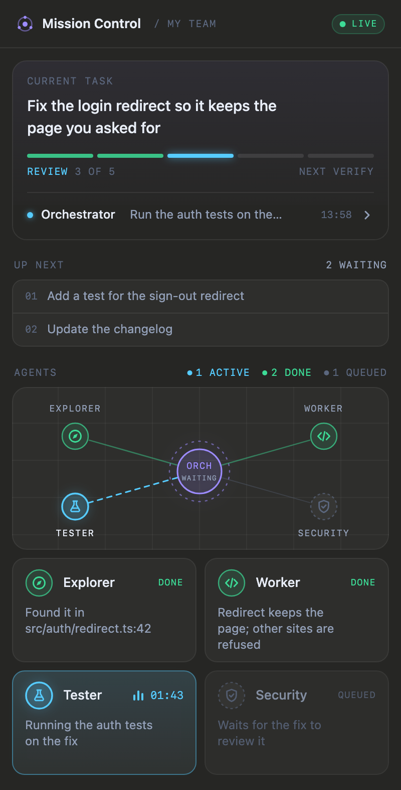
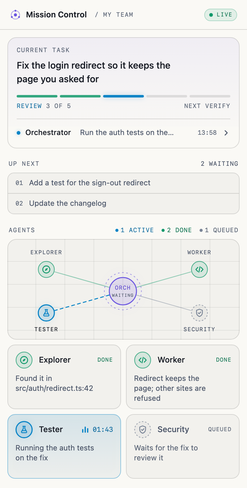

# Mission Control

Mission Control is a Claude Code plugin that adds a live side pane to the desktop app, and the same pane as text in a terminal session. It shows what an orchestrating session and its helper agents are doing: the task, its plan, who is working on what, what is waiting, and every dispatch and report between them. The orchestrator reports through a tool the plugin adds, and the plugin ships the rules for when and what to report, so any session with the plugin installed keeps the pane up to date.

<p>
  
  
</p>

## What the pane shows

The overview:

- **Header**: the title and a pill:
  - LIVE, in green, while a task runs and is being reported.
  - PAUSED when the orchestrator has paused the task on purpose: the plan is frozen at the step it stopped at, with "PAUSED AT <STEP>" and the time, and nothing moves. It never turns OFFLINE while paused.
  - OFFLINE when a running task has had no sign of life from anything for a minute: no write to `state.json` or `events.jsonl` by anyone (a report, a helper's line, the CLI) and no heartbeat from the orchestrator's plugin, which marks a running task fresh every 20 seconds from its own clock, idle or not: a line under the header says "No update since <time> · showing the last known state", everything below is dimmed and still, timers stop at that time, a working agent shows "LAST SEEN <time>", and the counts are labelled LAST KNOWN.
  - IDLE when no task is running and the orchestrator is not at work.
- **Current task**: the task's title, its plan as segments (one per step, the active one lit, skipped ones marked), and the latest update with who sent it and when. The chevron at the end of the update opens the Activity view.
- **Up next**: the queue of tasks waiting to start, the first two in full and a count of the rest.
- **Agents**: a graph with the orchestrator in the middle and its agents around it, a link lit while an agent works, then a card per agent with its status, what it is doing now, and for how long. The orchestrator's own status (planning, dispatching, waiting, reviewing) sits under its node. An agent that has handed in its report and waits for the orchestrator to read it shows IN REVIEW, in pink. The counts at the top say how many agents are active, in review, need you, done, queued and idle. Only states with at least one agent are shown, apart from ACTIVE, which always is; when they do not fit on one row they wrap onto a second, and the graph gives up the height.

The Activity view: the task's title and progress, then every event, newest first, with the time, who sent it to whom, and what it said. The chevron at the top left goes back.

## How to set it up

The pane shows nothing useful by itself. It shows a team at work, so it needs a team that reports to it.

### 1. The idea

One main Claude Code session acts as the orchestrator, a manager. It plans the task, hands each piece to a helper agent, checks what comes back, and reports every step to the pane. It does not do the helpers' jobs itself: it plans, dispatches, checks and reports.

### 2. The helpers

| Helper | What it does | Model tier |
| --- | --- | --- |
| Explorer | Finds where things are in the code. Read-only. | small and fast (`haiku`) |
| Worker | Makes a change from clear instructions, then runs the type-check and lint. | stronger (`sonnet` or `opus`) |
| Tester | Reproduces a problem, runs the checks, verifies a fix. Changes nothing. | small and fast (`haiku`) |
| Security | Reviews a change before it ships. Read-only. | stronger (`opus` or `sonnet`) |

These four have their own seats and icons in the pane. The pane is designed for one orchestrator and these four agents, and works best with four. More agents still work: the first four take the seats by the seat rule, the rest are counted as "+N" beside AGENTS, and the legend wraps to a second row when many states are present at once. Any other agent name shows with a generic bot icon.

### 3. Two ways to run the helpers

**(a) As subagents.** Copy the four files in [`examples/agents/`](examples/agents/) into your project's `.claude/agents/` folder (or `~/.claude/agents/` to have them in every project), and start a new session. The orchestrator then runs each helper as a subagent inside its own session, and you see their work in that session's transcript. This is the simplest way.

Each file is a name, a description that tells the orchestrator when to use it, the tools it may use (each includes `mcp__mission-control__report`, so the helper can add its own lines), the model tier, and a short prompt:

```markdown
---
name: explorer
description: Finds where things are in the codebase and reports paths with line numbers. Read-only. Use it before a change whenever the place to change is not already known.
tools: Read, Grep, Glob, mcp__mission-control__report
model: haiku
---

You find things in the codebase and report them. You never change anything.
Answer with exact paths and line numbers and one short line on what is there.
```

The other three, in the same folder:

- `worker.md`: tools `Read, Grep, Glob, Edit, Write, Bash` and the report tool, model `sonnet`. Changes only the files named, asks when the instructions are unclear, runs type-check and lint, and does not commit unless told to.
- `tester.md`: tools `Read, Grep, Glob, Bash` and the report tool, model `haiku`. Runs the checks and reports each as passed or failed with the failing output; never says passed for something it did not run.
- `security.md`: tools `Read, Grep, Glob, Bash` and the report tool, model `opus`. Uses Bash only to read, and reports findings by severity with file and line.

**(b) As separate sessions.** In the Claude desktop app, a session can start other sessions and send them messages. Ask the orchestrator to start one session per helper and to message it with each piece of work. Each helper session shows in the app's sidebar, where you can open it, watch it and talk to it. Give each helper session its role in its first message, or point it at the matching file in `examples/agents/`. Use this when you want to see each helper's work on its own.

Either way, the orchestrator reports the task, plan, queue and every agent's status. A helper never changes those, even with the plugin installed: the rules the plugin adds tell any session that was given its work by another one to leave them to the orchestrator. A helper may add short lines about its own work, which the pane shows under its name (see [Who writes what](#who-writes-what)).

### 4. What the orchestrator must do

The plugin adds these rules to every session's system prompt, and the full version is in its `mission-control` skill. In short:

- Start a task with a plain title.
- Write a plan of 3 to 7 steps taken from the task itself, one or two words each.
- Set each agent's status and a one-line current task. Mark an agent `queued` only when it will be used in this task; leave the others `idle`.
- When a helper's result arrives, first set it `in_review` with one line of what it reported, log the `report` event if the helper did not add its own, and set the orchestrator to `reviewing`. Only after reading it, set the helper `done` (accepted, with `agent_done`) or back to `working` (sent back, with a `dispatch`). `done` is never set before the report has been read.
- Log an event for every dispatch, report and change of state.
- Mark "needs you" with the exact question.
- Finish the task.

A worked example, from start to finish. Each block is one call to the `mcp__mission-control__report` tool; the line after it is what the pane shows.

```json
{ "updates": [
  { "do": "task.start", "title": "Fix the login redirect" },
  { "do": "plan.set", "steps": ["Find", "Fix", "Verify"] },
  { "do": "orch", "status": "planning" }
] }
```

The pill turns LIVE. The task card shows "Fix the login redirect" with three segments, Find lit. ORCH reads PLANNING. All four agents show IDLE, "No part in this task", until they are given a part.

```json
{ "updates": [
  { "do": "agent", "name": "Explorer", "status": "working", "task": "Finding where the login redirect is set" },
  { "do": "event", "type": "dispatch", "from": "Orchestrator", "to": "Explorer", "text": "Find where the login redirect is set" }
] }
```

Explorer's card turns active with its sentence and a timer. Its link to the orchestrator lights up. The latest update reads "Orchestrator: Find where the login redirect is set". Security has no part in this task and is never mentioned, so it stays IDLE throughout.

Explorer hands in its result. The orchestrator's first action, before it reads it, shows the hand-over:

```json
{ "updates": [
  { "do": "agent", "name": "Explorer", "status": "in_review", "task": "Reported: set in src/auth/redirect.ts:42" },
  { "do": "event", "type": "report", "from": "Explorer", "to": "Orchestrator", "text": "Set in src/auth/redirect.ts:42, read once at sign-in" }
] }
```

A pink packet runs from Explorer to the orchestrator. Explorer's card turns pink, IN REVIEW, with what it handed in and no timer; its link is a still pink line. ORCH reads REVIEWING.

```json
{ "updates": [
  { "do": "agent", "name": "Explorer", "status": "done", "task": "Found it in src/auth/redirect.ts:42" },
  { "do": "event", "type": "agent_done", "from": "Explorer", "to": "Orchestrator", "text": "Accepted: the redirect is set in src/auth/redirect.ts:42" },
  { "do": "plan.step", "step": "Fix", "status": "active" },
  { "do": "agent", "name": "Worker", "status": "working", "task": "Changing the redirect to keep the page asked for" },
  { "do": "event", "type": "dispatch", "from": "Orchestrator", "to": "Worker", "text": "Keep the page asked for in src/auth/redirect.ts" }
] }
```

The orchestrator has read the report and accepted it: Explorer shows DONE. Find is done and Fix is lit; Worker is active.

```json
{ "updates": [
  { "do": "agent", "name": "Worker", "status": "needs_user", "task": "Should a redirect to another site be allowed?" },
  { "do": "event", "type": "needs_user", "from": "Worker", "to": "Orchestrator", "text": "Should a redirect to another site be allowed?" }
] }
```

Worker's card shows the question in the "needs you" amber. The orchestrator asks you, and reports again once you answer.

```json
{ "updates": [
  { "do": "agent", "name": "Worker", "status": "in_review", "task": "Reported: redirect fixed, checks pass" },
  { "do": "event", "type": "report", "from": "Worker", "to": "Orchestrator", "text": "Fix in src/auth/redirect.ts, type-check and lint pass" }
] }
```

```json
{ "updates": [
  { "do": "agent", "name": "Worker", "status": "done", "task": "Redirect keeps the page; other sites refused" },
  { "do": "event", "type": "agent_done", "from": "Worker", "to": "Orchestrator", "text": "Accepted the fix in src/auth/redirect.ts" },
  { "do": "plan.step", "step": "Verify", "status": "active" },
  { "do": "agent", "name": "Tester", "status": "working", "task": "Running the tests on the fix" },
  { "do": "event", "type": "dispatch", "from": "Orchestrator", "to": "Tester", "text": "Run the tests on the fix" }
] }
```

Had the orchestrator not accepted the fix, it would set Worker back to `working` with what to fix, and log a `dispatch` saying so.

```json
{ "updates": [
  { "do": "agent", "name": "Tester", "status": "in_review", "task": "Reported: all 214 tests pass" },
  { "do": "event", "type": "report", "from": "Tester", "to": "Orchestrator", "text": "All 214 tests pass" }
] }
```

```json
{ "updates": [
  { "do": "agent", "name": "Tester", "status": "done", "task": "All 214 tests pass" },
  { "do": "event", "type": "agent_done", "from": "Tester", "to": "Orchestrator", "text": "Accepted: all 214 tests pass" },
  { "do": "event", "type": "task_done", "from": "Orchestrator", "to": "", "text": "Login redirect fixed; all tests pass" },
  { "do": "orch", "status": "done" },
  { "do": "task.done" }
] }
```

Every segment is done, the task shows as finished, and the Activity view (the chevron on the latest update) lists all of it, newest first. The same steps with the command-line writer are under [The optional command-line writer](#the-optional-command-line-writer).

### 5. A starter prompt

Paste this into your orchestrator session, or into your project's instructions file (`CLAUDE.md`) to make it the default:

```text
You are the orchestrator. For each task: plan it, hand each piece to a helper
(explorer finds, worker changes, tester checks, security reviews), check what
comes back, and give me the result. Do not do the helpers' work yourself.

Report every step to Mission Control with the mcp__mission-control__report tool,
following the mission-control skill:
- task.start with a plain title before any work; task.done or task.fail at the end.
- plan.set with 3 to 7 one- or two-word steps from the task itself; move on with plan.step.
- agent with each helper's status and one line on what it is doing now.
- an event for every dispatch, report, handoff and change of state.
- when a helper's result arrives: first set it in_review with one line of what it
  reported, log the report event, and set yourself reviewing; only after reading it,
  set it done (with agent_done) or back to working (with a dispatch).
- needs_user with the exact question whenever you or a helper need me.
Helpers never change the task, plan, queue or statuses. Put this line in every
brief, with the helper's role: "Add a progress line about your own work with the
report tool, as: <role>, do: say (3 to 8 per job); your last action before your final
message is one line with type: report (mc.py say --as <role> --report "...");
it is required, never skipped."
```

### 6. When it is working, and when it is not

When it is working, the pill says LIVE, the task card shows the title and plan, each helper's card changes as it is dispatched and reports back, and the latest update changes with every event.

When it is not:

- **The pill says OFFLINE.** A running task has had no sign of life for a minute: no write by anyone, and no heartbeat from the orchestrator's plugin. Check that the orchestrator's session is still open and has the plugin, and that it reported a task.
- **The pane shows only four idle agents.** Nothing has been reported yet on this machine. See the troubleshooting section below.

## Requirements

- Claude Code with plugin support. The desktop app draws the pane; a terminal session shows it as text (see [In the terminal](#in-the-terminal)). The tool and the rules work in both.
- Nothing else. The plugin writes its own files. Python 3 is needed only for the optional command-line writer in `cli/mc.py`.

## Install

At the prompt of a terminal session:

```
/plugin install mission-control --marketplace ammadbaig/mission-control
```

Answer `y` to add the marketplace, then choose a scope (the user scope is first; press Enter).

From a shell:

```
claude plugin install mission-control --marketplace ammadbaig/mission-control
```

In the desktop app, where `/plugin` does not run: click + next to the prompt box, then Plugins, Add marketplace with `ammadbaig/mission-control`, then Add plugin.

A plugin installed from a terminal at the user scope also loads in the desktop app's local sessions.

## How the orchestrator reports

The plugin adds a tool, `mcp__mission-control__report`, and a short section to the system prompt saying when to use it. The full rules, with examples, are in the plugin's skill, `mission-control`. In short:

- **Task**: `task.start` with a plain title before any work; `task.done` or `task.fail` at the end. **Every status is per task.** Done means the agent finished its part of the current task, and stays until that task ends. When a task ends (`task.done`, `task.fail`) or a new one starts, every agent becomes idle with no words; a paused task keeps its cards. Each agent's state and each event carry the id of the task that was current when they were written (`taskId`), and an agent whose state belongs to another task shows idle under this one. A state file written before task ids existed counts as the current task's. Work for something else is marked on its dispatch (`side: true` in the tool, `--side` on the CLI): it is logged with a quiet "Other task ·" mark in the Activity view, and while that helper's session runs its card shows working with its line starting "Other task:", and idle again when it ends (not in review). This was chosen over keeping the card idle while it runs, because a running session always shows working. When the orchestrator stops on purpose before the task is finished, it sends `task.pause` with a short `reason`, and `task.resume` when it goes on (`mc.py task pause --reason "..."`, `mc.py task resume`).
- **Plan**: `plan.set` with 3 to 7 steps of one or two words, taken from the task itself. Exactly one step is active; `plan.step` moves on. A step no longer needed is marked `skipped`, never deleted. Open-ended work gets `plan.clear`.
- **Queue**: a new task from the person while one runs goes to `queue.add`; a change to the running task is applied and logged as a `user_message` event. `queue.promote` starts the next one, and only once the running task is finished: while a task still runs it is refused, so a task is never dropped unfinished. Send `task.done` or `task.fail` first. `queue.remove` with an `index` from 1 takes one item out; `queue.clear` empties the queue.
- **Agents**: `agent` with a name, a status and one sentence on what it is doing. The statuses:
  - `idle`: no part in this task right now. Every agent is idle when a task starts, and one never mentioned stays idle. The sentence is optional; the card says "No part in this task", or "Waiting for a task" when none runs.
  - `queued`: has work coming in this task. Set it only for an agent the orchestrator plans to use, with what it is waiting for.
  - `working`: at work.
  - `in_review`: it has handed in its report and waits on the orchestrator. The sentence says what it reported.
  - `done`: the orchestrator has read its report and accepted the work, for this task. Never set before the report has been read; it clears when the task ends.
  - `needs_user`: waiting on you; the sentence is the exact question.
- **A helper's result**: the orchestrator's first action is the helper `in_review` and the `report` event (it then shows as reviewing by itself). After reading: `accept` (done, with `agent_done`), or `sendback` (working again, with a `dispatch`).
- **Orchestrator**: the orchestrator's status follows its agents, by one rule in both writers and the pane: whom it waits on is always the agents working, whom it reviews the agents in review; its status is REVIEWING while any agent is in review, WAITING while any works, DONE after `task.done`, else IDLE. The only statuses it sets itself are `planning`, `dispatching` and `needs_user` (`orch` with that status); each shows until an agent's state next changes. `waitingOn` and `reviewing` in an `orch` update (and `--waiting-on`, `--reviewing` on the CLI) are ignored.
- **Events**: one for every `dispatch`, `report`, `handoff`, `agent_done`, `needs_user`, `plan_changed`, `user_message`, `task_done` and `task_failed`; `progress` lines are the helpers' own; `task_paused` and `task_resumed` are logged by `task.pause` and `task.resume` themselves.
- **The task's own status**: `idle` (none runs), `running`, `paused`, `done` or `failed`, set by the task updates above, never directly.
- **Heartbeat**: while the session's task runs, the plugin marks the state fresh every 20 seconds, so the pill stays LIVE. Nothing to send.

### No status goes stale

- A helper's own lines move its own card at once: its first line to working, its report line to in review (below).
- The orchestrator accepts or sends back in the same turn in which it reads a report: `mc.py accept <agent>` or `--all` (done, `agent_done` logged), `mc.py sendback <agent> --task "..."` (working, a dispatch logged), or the same in the report tool.
- If the orchestrator tries to end its turn with an agent still in review, the plugin asks it once to accept, send back or say why (a Stop hook that re-prompts it in the same turn; once per agent per hand-in, so it cannot loop). It also asks once about an agent still working on a finished task. It never names an agent showing NEEDS YOU (that waits on you, not on the orchestrator) or one whose session is running again.
- An agent in review for more than 2 minutes shows how long ("IN REVIEW", "3 MIN"), so a forgotten review is visible as waiting on the orchestrator.
- The orchestrator's status follows its agents (above), in `state.json` as on the panel, whichever writer wrote last.

### What is automatic

Automatic reporting is on by default (`/mission auto off` turns it off, `/mission auto on` back on). The plugin watches the orchestrator's briefs and the notes it receives:

- A brief to a helper (SendMessage, `start_session`, or the Agent tool) logs a dispatch with the message's summary or first line (never the whole message), sets the agent working and the orchestrator waiting.
- A helper's result (the app's note when a session it started finishes a turn, or a subagent's answer) logs a report with the helper's own report line for that job when it wrote one, else just "Handed in": never words taken from its answer, the note or the subagent's result. It sets the agent in review and the orchestrator reviewing. A stopped or failed session is logged as such, and its status left alone.
- Each helper's card follows its session's own transcript, with nobody writing a status. Claude Code appends every session's turns to `<home>/.claude/projects/<folder>/<id>.jsonl`; the plugin finds each helper's file from the desktop app's record of that session (its working folder and id), checks it every second, and when it has changed reads its last 256 KB and never more (with `tail`, or PowerShell on Windows); when those hold no whole entry, the card is left as it was. From that part it takes only whether the last turn is running or has ended, and when; nothing the session said. A running turn shows the agent working, timed from the turn's start; a turn that ended after the agent's job began shows it in review, with the helper's own report line for that job when it wrote one, else just "Handed in": never words taken from its answer. Done, queued and idle stay the orchestrator's to set; a running session never shows anything but working (or needs you, while its permission prompt waits). `/mission agents Tester=<worktree name or transcript path>` maps one by hand. A turn has ended when its last answer stopped for any reason but a tool call or a server pause (`tool_use`, `pause_turn`: the turn goes on), such as `end_turn`, `max_tokens`, `stop_sequence` or a refusal, or the person interrupted it; an answer still being written (no stop reason yet) is running. The one intended exception to "a running session always shows working": a transcript that has not changed for 10 minutes is taken as not running, whatever its last line, and its working card shows idle, "Not running: last seen <time>", until the session writes again (a crashed session, or a single command that runs longer than that). A helper that hands in and then runs again (a brief was queued for it) shows working within a second of its transcript moving, with the last brief it was given as its task; the hand-in stays in the log. Accepting a helper whose session is running logs the acceptance (`agent_done`) and leaves its card on working, and the turn-end guard does not name it: it is not waiting on the orchestrator.
- The helpers' records: every 4 seconds the plugin reads the desktop app's record of each helper it knows (by the app's session id, learned from the orchestrator's own linked-sessions note or mapped with `/mission agents`), and no other session's record. From each it takes only the id, title, working folder, transcript id, last activity and whether the last turn has ended. For a helper whose transcript is not found, a record that says its turn has ended moves a working card to in review, again with its own report line or "Handed in". It does not run in the terminal, where there are no such records.
- A helper's question to you, seen from the orchestrator's session (no plugin needed in the helper's): when a helper's turn ends on a "next step" question (the box the app shows in the helper's chat, with buttons such as "Not now"), or a question tool (`AskUserQuestion`) waits for your choice, its card shows NEEDS YOU with that question (80 characters), one `needs_user` event is logged, and the legend counts it. A final message that only ends with a question mark does not count. When you answer (its session runs again), or the orchestrator answers for you with a new brief, the card is working again by itself. Needs you waits on you, so the turn-end guard does not name it.
- A helper's permission prompt mid-work. With the plugin loaded in the helper's session (installed for your user), NEEDS YOU shows within about 1 second of a prompt: a tool call of the helper's that has not returned after 1 second shows "May be waiting for you: <tool>" (the name only), and when Claude Code reports the prompt itself its exact words replace that at once ("Allow or deny: <tool> <file or host>"). Some of the desktop app's own consent prompts may never be reported, so the 1-second line is the one you see for those. A tool that simply takes longer than a second may show it for a moment; it clears by itself when the call returns. It clears as soon as the call returns, is allowed or denied, the next call starts, or the turn ends. The helper knows its own card from its brief's `--as <role>` line, else from the orchestrator's record of its session. Without the plugin there, the panel guesses after 10 seconds from a tool call still waiting for its result ("May be waiting for your permission: <tool>"), shell commands, subagents, skills and waits excluded; the call's result makes it working again. The guess is a guess: no file marks a prompt, and a slow tool call looks the same, so a slow non-shell tool can show it briefly; it clears by itself as soon as the call's result arrives. It never covers the helper's own exact NEEDS YOU, a question, in review or done.

Notes are read only when they come from the app itself (its notes and briefs), never from text you type or paste; from a note only the session's id, title and how its turn ended are taken. A permission prompt is logged by the tool's name and, at most, a file's name without its path or a site's host, never a command; a guessed one by the tool's name alone. The orchestrator still writes everything that needs judgement: the task, the plan, the queue, done or sent back, its own questions, idle and paused. Its own writes always win. A dispatch the orchestrator writes itself is always kept, even a second one to the same agent: it is a real second brief. Only an automatic copy is dropped: an automatic dispatch or report that repeats one already logged (a dispatch to an agent that has not reported since, within 10 minutes; a report after which no new dispatch came) is not written, and when the orchestrator's own copy follows an automatic one, its copy replaces it. Agents are matched by a role's name in a session's title, handle or subagent type; `/mission agents <role>=<id or title words>` maps any other. Nothing leaves your machine (see [Privacy](#privacy)).

### Who writes what

| Who | Writes |
| --- | --- |
| The orchestrator | the task, the plan, the queue, every agent's status, its own status, and the events for dispatches, reviews and the task's end |
| A helper | only lines about its own work: `progress` while it works, and one `report` when it hands in |

A helper calls the same tool with `as` set to its role and only `say` updates; the plugin refuses anything else from it, and never touches `state.json` for it:

```json
{ "as": "tester", "updates": [{ "do": "say", "text": "Running the visual tests: 3 of 20 done" }] }
```

or from a shell: `python3 cli/mc.py say --as tester "Running the visual tests: 3 of 20 done"`, with `--report` for the hand-in line.

A helper's own lines move its own card, and only its own. Its report line, its last action before its final message, shows it in review at once, with what it handed in. A plain line from an agent that is working and opens with a hand-in word (Done, Finished, Handing in, PASS or FAIL, in any case; Final or Report only with a colon or dash (`:`, `-`, `–` or `—`) right after the word, not bare and not after a space, so "Final: PASS" hands in and "Final check: PASS" is a progress line) counts as its report too. Any other line from an agent that is not working (queued, idle, in review or done) means it has started a job: it shows working again, its timer restarts, and that line becomes its task (a queued or idle agent keeps the task the orchestrator gave it). So a working helper never shows in review, and one in review never hides that it has started again. So statuses are instant for what a helper writes itself. The orchestrator's acceptance (done) or sending back follows when it has read the report: the app only wakes the orchestrator when none of the sessions it started is still working, so its own updates can come later. A helper adds about 3 to 8 lines per job (when it starts a distinct step, finds something or hits a problem), never one per command; a second progress line from the same agent within 5 seconds is dropped.

In the pane, an agent's lines show in the Activity view under its name with a cyan dot, a run of them within a minute under one heading; the orchestrator's own lines are quieter. The latest-update row shows the newest line of anyone. A working agent's card shows the task the orchestrator set, and under it, quieter, the agent's own newest line. Each progress line gives the agent's node one soft pulse.

A tool call takes several updates at once, applied in order:

```json
{ "updates": [
  { "do": "task.start", "title": "Fix the login redirect" },
  { "do": "plan.set", "steps": ["Find", "Fix", "Verify"] },
  { "do": "agent", "name": "Explorer", "status": "working", "task": "Finding where the redirect is set" },
  { "do": "event", "type": "dispatch", "from": "Orchestrator", "to": "Explorer", "text": "Find where the redirect is set" }
] }
```

The list stops at the first update that fails, and the tool says which one and why.

### The optional command-line writer

`cli/mc.py` writes the same files by the same rules, for a script or a tool that is not a Claude session. It needs Python 3 and nothing else:

```
python3 cli/mc.py task start --title "Fix the login redirect"
python3 cli/mc.py plan set "Find,Fix,Verify"
python3 cli/mc.py agent Explorer working --task "Finding where the redirect is set"
python3 cli/mc.py event dispatch --from Orchestrator --to Explorer --text "Find where the redirect is set"
python3 cli/mc.py agent Explorer in_review --task "Reported: set in src/auth/redirect.ts:42"
python3 cli/mc.py event report --from Explorer --to Orchestrator --text "Set in src/auth/redirect.ts:42"
python3 cli/mc.py agent Explorer done --task "Found it in src/auth/redirect.ts:42"
python3 cli/mc.py event agent_done --from Explorer --to Orchestrator --text "Accepted"
python3 cli/mc.py plan step Fix active
python3 cli/mc.py task done
```

On Windows, use `py` in place of `python3`. Run `python3 cli/mc.py -h` for every command. Steps are named by label or by number from 1, in the CLI and the tool alike.

You never need to start a heartbeat: the orchestrator's plugin keeps a running task LIVE by itself, whether the orchestrator reports through the tool or this CLI. `heartbeat-loop` is only for a script that reports through the CLI with no Claude Code session at all: it keeps the state fresh every 20 seconds while a task runs and exits when it ends. A second loop for the same data folder exits at once, unless the first one's process has gone (its lock is then replaced).

## Where the data lives

The plugin reads and writes two files in `<home>/.claude/mission-control/`: `~/.claude/mission-control/` on macOS and Linux, `%USERPROFILE%\.claude\mission-control\` on Windows. When `CLAUDE_CONFIG_DIR` is set, the folder is `mission-control` inside it. Set `MC_DIR` to use another folder; the tool and the command-line writer both read it.

`state.json` is one object:

```json
{
  "task": { "id": "a1b2c3d4", "title": "Fix the login redirect", "status": "running", "startedAt": 1767258000000 },
  "plan": [
    { "id": "s1", "label": "Find", "status": "done" },
    { "id": "s2", "label": "Fix", "status": "active" },
    { "id": "s3", "label": "Verify", "status": "pending" }
  ],
  "queue": [{ "id": "e5f6a7b8", "text": "Then update the changelog", "receivedAt": 1767258300000 }],
  "agents": [
    { "id": "explorer", "name": "Explorer", "status": "done", "currentTask": "Found it in the auth middleware", "startedAt": 1767258120000 }
  ],
  "orchestrator": { "status": "waiting", "waitingOn": ["Worker"] },
  "lastUpdated": 1767258360000
}
```

- `task.status`: `idle`, `running`, `done` or `failed`; `finishedAt` is added at the end. `task` is `null` when there is none.
- `plan` is `null` for open-ended work. A step's status is `pending`, `active`, `done` or `skipped`.
- Times are milliseconds since 1970 (UTC).

`events.jsonl` has one event per line, oldest first:

```json
{"time": 1767258060000, "type": "dispatch", "from": "orchestrator", "to": "explorer", "text": "Find where the redirect is set"}
```

The pane ignores fields it does not know and keeps its last good state when a file is half-written. Text is cut to fit: titles and agent tasks at 80 characters, events at 100, queue items at 120, step labels and names at 24. Past 512 KB the event log keeps its newest 500 lines.

Both writers refuse, with a clear message, a plan of more than 12 steps (3 to 7 is the guide), a queue of more than 50 items, more than 12 agents, and more than 50 updates in one tool call.

When `state.json` is there but is not a valid state (cut short by a crash, say), the next report keeps it as `state.json.bad` before a clean state replaces it, and says so: the tool in its result, the CLI on stderr. A `state.json` the tool cannot read at all stops the report, so nothing is lost. If the tool cannot read `events.jsonl`, it leaves the log as it is and says that this report's events were not written.

## Commands

- `/mission` opens the pane. In the desktop app it also opens by itself when a session starts; in a terminal session it opens as text.
- `/mission ascii on`, `off` or `auto` (the default) chooses the terminal pane's glyphs: plain ASCII, the block characters, or ASCII only where the terminal cannot draw the others.
- `/mission light`, `/mission dark` pin a theme; `/mission auto` follows the app again (the default).
- The pane is always drawn at once, and a resize just redraws it at the new size. Its width comes from the pane's columns (10.68px each, set for the desktop app at its default text size: the panel fills the width) and its height from its rows (20.3px each by default, on the short side, so no card falls below the pane). `/mission size <px>` sets the row height by hand (12 to 32: a smaller value keeps more in view, a larger one uses more of a tall pane) and `/mission size auto` goes back to the default; `/mission measure` measures it (the pane shows its measuring drawing for a moment, only when you ask). Either is kept in the data folder (`.panel.json`) for every session. With `/mission debug on`, the pane's columns and rows, the column and row sizes in use, where the row size came from, the scale and the height budget are written to `.panel-debug.json` whenever the columns or rows change.
- `/mission auto on` or `/mission auto off` turns automatic reporting on (the default) or off.
- `/mission debug on` or `/mission debug off` writes each brief call (its name and input keys, never the message) and each note's handling to `.panel-debug.json` in the data folder.
- `/mission watch on` or `/mission watch off` turns following helper sessions (their transcripts and the app's records) on (the default) or off.
- `/mission agents` shows the loaded version and lists the role mappings; `/mission agents Reviewer=local_1234` adds one (a session id, handle or title words), `Reviewer=` removes it.
- `/mission role tester` (in a helper session) says which helper it is, if its brief did not; `/mission role none` undoes it.

## Theme and motion

The pane follows the app's light or dark theme and draws no background of its own. Updates do not blink: a drawing whose content has not changed is kept as it is (its source text may differ only in the animation delays that keep its pulses in step, and the pane treats that as unchanged), so the app keeps its frame and its animations run on; a changed drawing is laid under the one it replaces until it has loaded (400ms). Working agents pulse and their links carry a moving signal. When the system asks for reduced motion, the pulses and signals stop and the timers still count.

## Limits

- Each machine shows its own sessions: the pane reads files on the machine it runs on.
- One orchestrator at a time. Two sessions reporting at once write the same files, and the last write wins.
- Writes are not atomic: the plugin's file access has no rename. The pane keeps its last good state when it meets a half-written file, so this shows at worst as a one-second delay. The command-line writer does write atomically.
- The pane is drawn for its own width, up to 400 pixels; a wider pane centres it. The overview fits the pane's height and does not scroll; the Activity view scrolls.
- Only the two chevrons can be clicked: the one on the latest update, and Back in the Activity view.
- The pane is designed for one orchestrator and four agents: Explorer, Worker, Tester and Security, which have their own seats and icons. It works best with four. More agents still work: the first four take the seats (an agent at work takes a seat before one that is only queued or idle), the rest are counted as "+N" beside AGENTS, and every reported agent is counted in the legend. Other names are drawn with a generic bot icon.
- The legend beside AGENTS shows only states with at least one agent, and ACTIVE always. When many states are present at once it wraps onto a second row, and the graph above the cards gets that much shorter so the overview still fits the pane.

### Windows

Mission Control is built for macOS and Windows alike, but it has been run only on macOS. Nothing has been run on a Windows machine yet. What was checked, on a Mac:

- The plugin's tests run with a Windows home folder (`USERPROFILE` set to `C:\Users\…`, no `HOME`). They check that the data folder becomes `C:/Users/…/.claude/mission-control`, that a report writes both files there, that the pane draws it, and that the heartbeat runs. The plugin needs no Python, Node or other program on the machine.
- The font stacks name Segoe UI, Cascadia Mono and Consolas after the Mac faces, and the files are kept with LF line endings.

Not yet checked on Windows:

- That Claude Code's file access on Windows takes `C:/…` paths and that `USERPROFILE` is set the way the plugin expects.
- Reading a file while another process writes it, which Windows locks more strictly than macOS.
- Text widths: the pane cuts long text to fit using measurements of the Mac fonts, so on Windows a line may end slightly early or late.
- `py cli/mc.py`, the optional command-line writer.

If you run it on Windows, please open an issue with what you see.

### Not covered by the transcripts

- A helper running in a cloud session, or on another machine: its transcript is not on this disk.
- The terminal alone: there are no app records to find a helper's transcript from; `/mission agents <role>=<path to its .jsonl>` maps one by hand.
- A permission prompt waiting: the transcript shows only a tool call with no result yet, the same as a slow one. Exact only with the plugin in the helper's session; otherwise a guess after 10 seconds, never for shell commands (above).

A better route once the plugin runs in every helper session: each helper's plugin writes a small status file of its own (`<data>/sessions/<id>.json`: running, ended or waiting on the person, with the time) at turn start, turn end and each permission prompt, which the pane reads directly. It would cover permission prompts exactly; the transcripts stay the source for any helper without the plugin, and both give the same three states.

## Privacy

On this machine only, the plugin reads:

- its own data folder (`state.json`, `events.jsonl`, and two small files of its own: `.panel.json`, the pane's row height when you set or measured one, and `.roles.json`, which helper session is which role, by session id);
- in the orchestrator's session, the desktop app's record of each known helper session (not any other session's), and the last 256 KB of each of those helpers' transcripts, only to tell whether a turn is running or has ended, and whether it asks you a question;
- with `/mission agents <role>=<path>` or `=<worktree name>`, the transcript you name, the same way.

It writes only to its data folder: each agent's status, and one short line per event. A helper's words reach that file only when the helper writes them itself (its progress and report lines), and in one other case: a question it asks you (its next-step question or its question tool's question) is logged as that question alone, cut to 80 characters, never the text around it. An automatic hand-in says only "Handed in". The orchestrator's briefs are logged by their summary or first line, a permission prompt by its kind only.

`/mission watch off` stops reading the helpers' records and transcripts; `/mission auto off` stops all automatic reporting. Nothing leaves the machine: the plugin makes no network calls.

## In the terminal

In a terminal session, `/mission` opens the same pane as text: the same data, rules and commands as the desktop pane, laid out in the pane's columns and rows. A real capture, at 100 columns:

```text
Mission Control                                                                             LIVE
[ Activity ]
Package Mission Control as an installable plugin for Mac and PC
■■■▣□□□
NEEDS YOU ON PERMISSION 4 of 7 · next Final recheck
Orchestrator  Worker: Needs you for permission prompts                                     21:27
AGENTS                                                              1 ACTIVE · 1 DONE · 2 QUEUED
✓ Explorer                                                                                  DONE
▸ Worker                                                                           WORKING 11:45
◌ Tester                                                                                  QUEUED
◌ Security                                                                                QUEUED
```

- Top to bottom: the title and the pill word (LIVE, PAUSED, OFFLINE or IDLE); the task's title, its steps (`■` done, `▣` current, `□` to come, `·` skipped, `✕` where it failed) and the caption, or `working 12:34` with no plan; the latest update; up next (two, then `+N more`); the agents' counts and one row per agent (a marker, the name, the state word and its timer: `▸` working, `✓` done, `?` needs you, `↺` in review, `◌` queued, `·` idle), with its task line under it.
- It fits the pane: no line is wider than its columns, and when the rows are short each agent's task takes one line, then the blank lines go, then the task lines, so the state rows always show. What still does not fit scrolls.
- Every state is a word as well as a colour, so it reads in a light or dark terminal and in plain monochrome. The colours are the terminal theme's own.
- Hotkeys, while the pane has the focus (ctrl+x tab): `a` opens Activity, the list of events newest first; `b` goes back. The buttons do the same with a click or Enter.
- `/mission ascii on` draws it with plain ASCII (`[xxx>--]`, `>` working, `v` done, `?` needs you, `<` in review, `o` queued, `.` idle); `/mission ascii off` the block characters; `/mission ascii auto` (the default) chooses ASCII by itself when the locale is not UTF-8 or the terminal is a bare console (`TERM` linux or dumb).
- What differs from the desktop pane: no graph of the agents and no packets; nothing animates except the timers, which tick once a second; there is no theme switch (`/mission light|dark` is for the desktop drawing). Offline, paused and idle follow the same rules.

## Uninstall

From a shell:

```
claude plugin uninstall mission-control
```

The data folder is left in place; delete `<home>/.claude/mission-control/` to remove it too.

## Troubleshooting

- **The pill says OFFLINE.** A task is running but there has been no sign of life for a minute: the orchestrator's session may have ended (or lost its plugin) without pausing the task. A new report brings it back to LIVE. An orchestrator that stops on purpose should send `task.pause`, which shows PAUSED instead.
- **The pane is empty, or shows only the four agents idle.** Nothing has been reported yet. Check that the session is reporting: ask it to start a task, or run `python3 cli/mc.py heartbeat` and look for `state.json` in the data folder. If you set `MC_DIR`, make sure the session and the pane see the same value.
- **The bottom cards fall below the pane, or space is left at the bottom.** The row height is off for your text size: `/mission size <px>` sets it (smaller keeps more in view; the default is 20.3), or `/mission measure` measures it. With `/mission debug on`, `.panel-debug.json` shows the numbers in use.
- **The pane does not open.** Run `/mission`. In the terminal it opens above the prompt, or docked beside the transcript in fullscreen.
- **The terminal pane shows boxes or question marks for its glyphs.** Run `/mission ascii on`.

## Development

The plugin is TypeScript that Claude Code runs directly: there is no build step and nothing to install with npm to use it.

The type-check needs one folder the package does not ship: the engine's type declarations, `.claude-plugin/types/claude-code/` (ignored by git). Claude Code writes it when it loads the plugin from this folder in an interactive session; `claude plugin test` and `claude plugin validate` do not write it. So, once:

1. Start an interactive session with the plugin, from this folder:

   ```
   claude --plugin-dir .
   ```

   For a folder it has not seen, Claude Code first asks whether you trust it. The plugin loads only after you answer yes, so nothing is written until then. Quit once the session has started.

2. Then, with TypeScript 5.4 or newer:

   ```
   npx tsc -p .
   ```

Without the declarations, `tsc` stops with `error TS2688: Cannot find type definition file for 'claude-code'` (exit 2); with them it reports nothing (exit 0). The same folder from any other plugin Claude Code has loaded works too: copy its `.claude-plugin/types/claude-code/` here. Claude Code also writes `claude-code-tools` and `claude-code-mcp` beside it; this package does not need them. `tsconfig.json` holds every other option itself. `types/index.d.ts` uses `Shaped`, which those declarations provide.

The lists the package names in several places (event types, statuses, update kinds) are checked against the plugin's writer, and the CLI against the plugin, by:

```
python3 tests/check-lists.py
```

The command-line writer's own checks (the orchestrator rule, the heartbeat lock), each in a scratch folder:

```
python3 tests/cli-test.py
```

The tests run in Claude Code's own test kit, and the manifest check is the same command the plugin directory uses:

```
claude plugin test .
claude plugin validate .
```

The plugin's timers: the reader checks the files once a second for as long as the session runs, and only one reader runs at a time. In the orchestrator's session, a heartbeat marks a running task fresh every 20 seconds; the plugin's clock runs between turns too, so an idle orchestrator stays LIVE. The transcript follower looks once a second, and again right after each of the plugin's own writes. When the plugin reloads, Claude Code drops all of its timers itself.

## Credits

The orbit icon, the role glyphs, the illustrations and the design of the pane come from the author's own design file.
